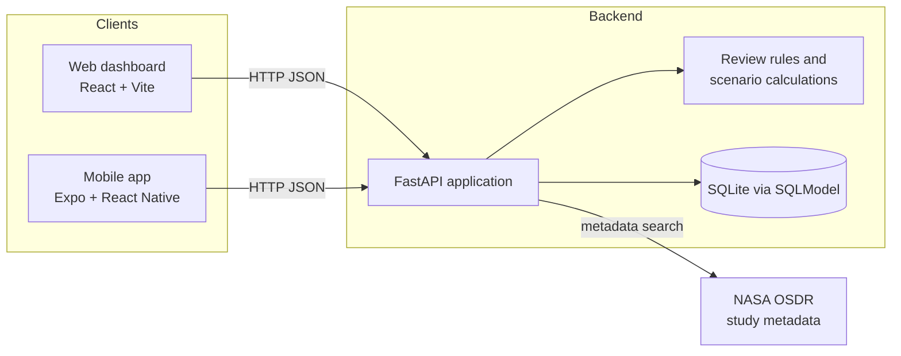

<div align="center">

# ASTRA-MED X

### Astronaut Health Monitoring and Mission Support

A research prototype that brings crew health indicators, spaceflight hazard evidence, NASA research metadata and deep-space communication scenarios into one mission dashboard.

**NASA Space Apps Challenge 2026**


</div>

> [!IMPORTANT]
> ASTRA-MED X is an independent student research prototype. It is not developed, certified or endorsed by NASA, and it is not a clinical device or a flight system. All data generated by the demo is labelled `SIMULATED`.

## Contents

- [Why this project](#why-this-project)
- [Features](#features)
- [Architecture](#architecture)
- [Tech stack](#tech-stack)
- [Getting started](#getting-started)
- [Configuration](#configuration)
- [API overview](#api-overview)
- [Importing datasets](#importing-datasets)
- [NASA data and provenance](#nasa-data-and-provenance)
- [Testing](#testing)
- [Project structure](#project-structure)
- [Scope and limitations](#scope-and-limitations)

## Why this project

On long missions to the Moon and Mars, crews face five well-known hazards: space radiation, isolation and confinement, distance from Earth, altered gravity, and a hostile closed environment. As the distance grows, so does the communication delay, and the crew can no longer rely on an immediate answer from the ground.

ASTRA-MED X explores how a single platform can organize health indicators, hazard observations and research evidence so that the crew and mission control can review them clearly, with every value traceable to its source and every decision left to a qualified human.

## Features

| Area | What it does |
| --- | --- |
| **Mission control dashboard** | Responsive web dashboard with a crew profile selector, latest health indicators, trends, priority signals and a review queue. |
| **Daily crew health check** | Self-assessment form for vital signs, sleep, fatigue, mood, hydration, body mass, exercise and workload. |
| **Health intelligence** | Transparent review rules for heart rate, oxygen signal, sleep and fatigue, plus a personal rolling baseline with deviation scores when enough history exists. |
| **Five-hazard framework** | Information center covering radiation, isolation and confinement, distance from Earth, gravity fields and hostile closed environments. |
| **Hazard evidence ledger** | Source-labelled observations for radiation, behavioral, distance, gravity, habitat, immune, cardiovascular and sensorimotor domains, stored separately from vital-sign readings. |
| **Deep-space resilience lab** | Communication delay and outage calculator showing one-way and round-trip delay, queued message count and estimated payload size, with offline workflow guidance. |
| **Digital-twin scenarios** | Crew state summary with clearly labelled what-if scenarios. |
| **Medical copilot** | Deterministic summary of the available evidence for a crew member, always with its data sources shown. |
| **Emergency simulation lab** | Tabletop workflows for communication loss, degraded telemetry, fatigue and oxygen-sensor alerts. |
| **Mission data repository** | Upload CSV or JSON files, preview them, choose their provenance and import them in batches. |
| **NASA research workspace** | Search NASA Open Science Data Repository (OSDR) study metadata from inside the app. |
| **Research benchmark** | Seeded synthetic test signal with a confusion matrix for checking the review rules. |
| **Mobile client** | Expo app with demo role selection, health summary, a local queue for offline records and manual sync. |
| **Audit trail** | Audit events recorded for key actions. |

## Architecture



The web dashboard and the mobile app both talk to the same FastAPI backend. The backend validates requests, runs the review rules and scenario calculations, stores records through SQLModel, and queries NASA OSDR for study metadata when asked.

## Tech stack

| Layer | Technology |
| --- | --- |
| Web frontend | React 18, TypeScript, Vite, Recharts, Lucide icons |
| Mobile | Expo SDK 58, React Native, Expo Router, Expo Secure Store |
| Backend | Python 3.12, FastAPI, Uvicorn, Pydantic |
| Data | SQLModel with SQLite |
| Numerics and HTTP | NumPy, HTTPX |
| Testing | Pytest |
| Containers | Docker, Docker Compose |

## Getting started

### Prerequisites

- Python 3.12
- Node.js 22 or newer, with npm
- Git

### 1. Clone the repository

```powershell
git clone https://github.com/youemeeare/Astronaut-Health-Monitoring.git
cd Astronaut-Health-Monitoring
```

### 2. Install everything at once (Windows)

The install script checks for Python and Node.js, then installs the backend, web and mobile dependencies.

```powershell
.\install.ps1
```

Prefer to do it by hand? Follow the steps below instead.

### 3. Run the backend

```powershell
cd backend
py -3.12 -m venv .venv
.\.venv\Scripts\Activate.ps1
pip install -r requirements.txt
uvicorn app.main:app --reload
```

The API runs at `http://127.0.0.1:8000`, with interactive documentation at `http://127.0.0.1:8000/docs`.

### 4. Run the web dashboard

Open a second terminal:

```powershell
cd frontend
npm install
npm run dev
```

Open `http://localhost:5173`. The backend must be running for the dashboard to load data.

### 5. Run the mobile app (optional)

```powershell
cd mobile
npm install
npx expo install --fix
```

Create `mobile/.env` so the phone can reach the API. Use the LAN address of your computer (find it with `ipconfig`), not `localhost`:

```
EXPO_PUBLIC_API_URL=http://YOUR_PC_LAN_IP:8000
```

Then start Expo:

```powershell
npx expo start
```

Keep the phone and the computer on the same trusted network.

### Run with Docker (alternative)

```powershell
docker compose up --build
```

This starts the API on port 8000 and the web dashboard on port 5173.

## Configuration

The backend reads its settings from environment variables. Defaults work for local use. See [.env.example](.env.example).

| Variable | Default | Purpose |
| --- | --- | --- |
| `DATABASE_URL` | `sqlite:///./astra_med.db` | Database connection string. |
| `ASTRA_DEMO_MODE` | `true` | Enables the open demo login for local demonstrations. |
| `ASTRA_TOKEN_SECRET` | random per start | Secret used to sign demo tokens. Set a long random value to keep sessions across restarts. |
| `CORS_ORIGINS` | `http://localhost:5173,http://localhost:8081` | Origins allowed to call the API. |
| `VITE_API_URL` | `http://localhost:8000` | API address used by the web dashboard. |
| `EXPO_PUBLIC_API_URL` | none | API address used by the mobile app. |

## API overview

All routes are listed with request and response schemas at `/docs` while the backend is running.

| Group | Endpoints |
| --- | --- |
| Status | `GET /health` |
| Authentication | `POST /api/v1/auth/demo-login`, `GET /api/v1/auth/me` |
| Crew profiles | `GET /api/v1/profiles`, `POST /api/v1/profiles` |
| Health readings | `GET /api/v1/readings`, `POST /api/v1/readings`, `POST /api/v1/readings/bulk` |
| Health review | `GET /api/v1/health-summary`, `GET /api/v1/intelligence/assess` |
| Hazard evidence | `GET /api/v1/hazard-observations`, `POST /api/v1/hazard-observations`, `GET /api/v1/hazard-summary` |
| Mission | `GET /api/v1/mission/brief`, `POST /api/v1/mission/link-simulation` |
| Scenarios | `GET /api/v1/digital-twin`, `POST /api/v1/digital-twin/simulate`, `POST /api/v1/emergency/simulate`, `GET /api/v1/environment/risk` |
| Copilot | `POST /api/v1/copilot` |
| Research | `GET /api/v1/nasa/search`, `GET /api/v1/research/datasets`, `POST /api/v1/research/datasets/import`, `GET /api/v1/research/benchmark` |
| Demo and audit | `POST /api/v1/demo/simulate`, `GET /api/v1/audit` |

Demo roles: `astronaut`, `medical_officer`, `mission_control`, `admin`.

## Importing datasets

Use the Mission Data Repository page to upload a CSV or JSON file.

1. Download the CSV template from the app for a starter format.
2. Upload your file and check the preview.
3. Choose the correct provenance: `MANUAL`, `SENSOR`, `SIMULATED` or `NASA_RESEARCH`.
4. Import. Records are sent in batches of 250, up to 50,000 rows per file.

Recognized column names include `recorded_at`, `heart_rate_bpm`, `spo2_percent`, `temperature_c`, `sleep_hours`, `fatigue_score`, `systolic_mmhg`, `diastolic_mmhg`, `glucose_mg_dl`, `mood_score`, `workload` and `radiation_msv`.

`MANUAL`, `SENSOR` and `SIMULATED` rows can be mapped into crew readings. `NASA_RESEARCH` rows are kept as raw research records in a separate store and are never treated as live crew telemetry.

More detail: [docs/DATA_IMPORT.md](docs/DATA_IMPORT.md) and [docs/DATA_MODEL.md](docs/DATA_MODEL.md).

## NASA data and provenance

- The app connects to **NASA OSDR study metadata search**. It does not bundle NASA raw datasets, train on astronaut data or receive live astronaut telemetry.
- NASA Human Research Program material informs the five-hazard framework.
- Every record carries a provenance label, so simulated, manual, sensor and research data are never mixed up.
- Research files keep their study reference, units and access conditions.

Further reading in this repository:

| Document | Topic |
| --- | --- |
| [NASA_PROBLEM_MAPPING.md](docs/NASA_PROBLEM_MAPPING.md) | How the modules map to NASA human-spaceflight problems |
| [NASA_DATA_AND_COMPLEMENTARITY.md](docs/NASA_DATA_AND_COMPLEMENTARITY.md) | Candidate NASA studies and data access notes |
| [IMPLEMENTATION_ROADMAP.md](docs/IMPLEMENTATION_ROADMAP.md) | Planned next steps |
| [TEAM_WORKSTREAMS.md](docs/TEAM_WORKSTREAMS.md) | Team workstreams |

## Testing

```powershell
cd backend
pytest -q
```

The backend tests cover the hazard evidence contracts and the health review rules.

## Project structure

```
.
├── backend/              FastAPI application and tests
│   ├── app/main.py       API routes, models and scenario logic
│   ├── tests/            Pytest suite
│   └── requirements.txt
├── frontend/             React and Vite web dashboard
│   └── src/
├── mobile/               Expo mobile client
│   └── app/
├── docs/                 Design notes and NASA data documentation
├── docker-compose.yml
├── install.ps1           Windows dependency installer
└── .env.example
```

## Scope and limitations

ASTRA-MED X is a demonstrator, and its outputs should be read that way.

- **Not medical advice.** Alert thresholds are demonstration triggers, not clinical thresholds. Personal baselines are descriptive and are not a diagnosis.
- **Simulated data stays simulated.** Demo telemetry is always labelled `SIMULATED` and must not be presented as NASA or astronaut data.
- **Simple models.** The digital twin is a state summary with what-if arithmetic, not a validated physiological model. The radiation scenario multiplies a supplied rate by mission duration and is not a dose or risk model.
- **Deterministic copilot.** The copilot summarizes stored evidence and does not retrieve NASA medical protocols.
- **Tabletop emergencies.** Emergency workflows are training prompts. They do not command spacecraft, devices or treatment.
- **Calculator, not a network.** The communication lab computes delays and queue sizes. It does not transmit over a real deep-space link.
- **Demo security.** The demo login is open by design for local use. Do not enter real astronaut, patient or other sensitive health data.

Real-world use would require validated devices, clinical and scientific validation, security review, data authorization and mission authority approval.

## Acknowledgements

- [NASA Human Research Program](https://www.nasa.gov/hrp/) for the five hazards of human spaceflight
- [NASA Open Science Data Repository](https://osdr.nasa.gov/) for open space-biology research metadata
- [NASA Space Apps Challenge](https://www.spaceappschallenge.org/)
